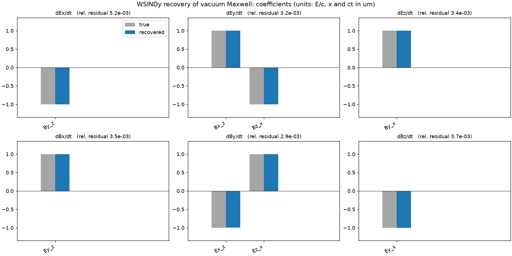

# ML on PIC

Learning plasma equations from particle-in-cell simulations with weak-form sparse regression.

The long-term goal is to recover non-local heat-flux closures in collisionless plasmas directly from kinetic data. Before that, the pipeline has to work on a problem where the answer is known.

## Vacuum pulse: recovering Maxwell's equations

A 2D WarpX simulation of a pulse propagating in vacuum, in the x–z plane, with all six field components (Ex, Ey, Ez, Bx, By, Bz). WSINDy (Messenger & Bortz 2021) is given a library of candidate terms (every field and its first spatial derivatives) and has to pick out the ones that govern each field's time evolution.

**Result:** WSINDy recovers vacuum Maxwell from the WarpX data exactly in structure, with coefficients within 0.25% of ±1, and stays exact up to ρ = 1 white noise (noise standard deviation equal to the RMS of each field).

```
dEx/dt = -By_z    dEy/dt = Bx_z - Bz_x    dEz/dt =  By_x
dBx/dt =  Ey_z    dBy/dt = Ez_x - Ex_z    dBz/dt = -Ey_x
```

(units: E/c, with x and ct in the same length unit)

This validates the pipeline. It is not new physics: recovering known equations from PIC data with weak/integral sparse regression has already been done (Alves & Fiuza 2022).



### How it works

- **Weak form.** Each equation is multiplied by smooth, compactly supported test functions φ = (s−a)⁴(b−s)⁴ and integrated over many small space-time windows. Integration by parts moves every derivative onto φ, so the noisy data is never differentiated.
- **Sparse regression.** Modified sequential thresholded least squares (MSTLS), with the threshold chosen automatically by scanning λ and balancing distance to the full least-squares fit against the number of terms.
- **Noise test.** Gaussian noise is added to every field before fitting, at a fixed ratio to that field's RMS, and the recovery is tracked as the ratio increases.

### Running it

```bash
conda activate warpx
cd "Vacuum Pulse"
python run-vacuum.py                       # WarpX run -> run/diags/diag1
python convert-to-npz.py                   # openPMD output -> maxwell_vacuum.npz
python maxwell-wsindy.py all --noise 0.05  # fit + all plots -> plots/
```

`maxwell-wsindy.py` also runs a noise sweep (`--sweep 0 0.01 0.05 0.1 0.2 --seeds 3`). The original C++/Eigen version of the regression is in `wsindy_maxwell.cpp`.

## In progress: non-local heat-flux closures

The next step is the actual target: the heat flux q in a collisionless plasma, which is non-local and has no exact fluid closure. I write candidate closures in Fourier space as

q̃ₖ ∝ −i sgn(k) |k|^β T̃ₖ

β = 1 gives local conduction (q ∝ −∂ₓT), and β = 0 gives Hammett–Perkins (essentially a Hilbert transform of T). Learning β from data gives a direct measure of how non-local the transport is. Bonus: operators with β ≤ 1 amplify noise much less than ordinary derivatives, which matters because q is a third moment and the noisiest thing we extract from PIC.

β enters nonlinearly, so instead of sparse regression this part uses a WENDy-style weighted likelihood fit (Rummel et al. 2025), with the particle-noise covariance measured from independent seeds. On synthetic data with a known closure it recovers β to within its error bars. The kinetic PIC runs (1D electrostatic, WarpX) are underway; at 1000 particles per cell the moment noise is still too large, so the current work is a step-by-step validation before scaling up. Code is in `Hammit-Perkins/`.

## References

- D. A. Messenger, D. M. Bortz, *Weak SINDy for partial differential equations*, J. Comput. Phys. 443, 110525 (2021).
- E. P. Alves, F. Fiuza, *Data-driven discovery of reduced plasma physics models from fully kinetic simulations*, Phys. Rev. Research 4, 033192 (2022).
- N. Rummel, S. Becker, D. Messenger, V. Dukic, D. Bortz, *Weak form estimation of nonlinear dynamics (WENDy) for nonlinear-in-parameters ODEs*, arXiv:2502.08881 (2025).
- G. W. Hammett, F. W. Perkins, *Fluid moment models for Landau damping with application to the ion-temperature-gradient instability*, Phys. Rev. Lett. 64, 3019 (1990).
- E. R. Ingelsten et al., J. Plasma Phys. 91, E64 (2025).

## Tools

[WarpX](https://github.com/BLAST-WarpX/warpx) · Python (NumPy, SciPy, Matplotlib, openPMD-viewer) · C++/Eigen · SLURM on MSU ICER HPCC
